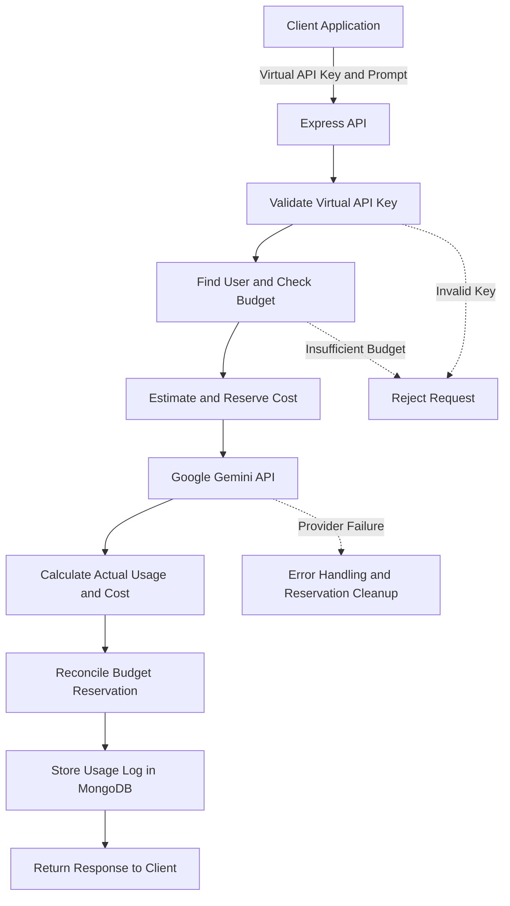
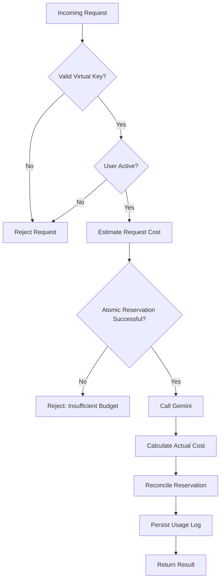

# Minimal LLM Gateway

A lightweight, budget-aware LLM gateway built with **Node.js, Express.js, MongoDB, and Google Gemini**.

Minimal LLM Gateway sits between your application and an LLM provider, allowing you to manage access through virtual API keys, enforce per-user spending limits, track token usage, and maintain request-level logs — without exposing your provider API key to clients.

<p align="center">
  
  
  
  
</p>

---

## Table of Contents

- [Overview](#overview)
- [Key Features](#key-features)
- [Architecture](#architecture)
- [Tech Stack](#tech-stack)
- [Project Structure](#project-structure)
- [Getting Started](#getting-started)
- [API Reference](#api-reference)
- [Budget Enforcement](#budget-enforcement)
- [Error Handling](#error-handling)
- [Testing](#testing)
- [Limitations and Future Improvements](#limitations-and-future-improvements)
- [Documentation](#documentation)

---

## Overview

Applications that integrate directly with an LLM provider need a secure way to manage API access, control spending, and monitor usage.

Minimal LLM Gateway introduces a backend layer between the client and the provider to centralize these responsibilities.

Instead of exposing your Gemini API key, clients authenticate using a **virtual API key** issued by the gateway.

The gateway validates the key, checks the associated user's budget, reserves an estimated request cost, calls the LLM provider, and records usage information.

### Why use an LLM Gateway?

- **Secure access:** Keep provider credentials on the server.
- **Cost control:** Enforce spending limits before making provider calls.
- **Usage tracking:** Monitor token consumption and estimated request costs.
- **Concurrency safety:** Atomically reserve budget to reduce overspending from simultaneous requests.
- **Request history:** Store request-level usage and status information in MongoDB.
- **Centralized integration:** Provide a single backend interface for communicating with an LLM provider.

## Key Features

| Feature | Description |
| --- | --- |
| Virtual API keys | Generate keys for gateway users and store their SHA-256 hashes |
| Gemini integration | Send non-streaming completion requests to Google Gemini |
| Budget enforcement | Reject requests that exceed the user's available budget |
| Cost reservation | Reserve estimated request cost before calling the provider |
| Token accounting | Calculate usage and estimated cost from provider usage data |
| Request logging | Store request-level records in MongoDB |
| Usage summaries | Retrieve aggregated usage information |
| Request history | Retrieve historical requests with pagination |
| Atomic reservations | Protect available budgets during concurrent requests |
| Model registry | Centralize supported model configuration |
| Error handling | Handle validation, authentication, budget, provider, and internal errors where implemented |

---

## Architecture



### Request lifecycle

1. The client sends a prompt and virtual API key.
2. The gateway hashes and validates the key.
3. The associated user's status and available budget are checked.
4. The gateway estimates and atomically reserves the request cost.
5. Gemini processes the prompt.
6. The gateway calculates actual usage and reconciles the reservation.
7. Request information is recorded in MongoDB.
8. The generated response is returned to the client.

The exact failure-recovery behavior depends on the implemented controller and reservation cleanup logic.

---

## Tech Stack

| Technology | Purpose |
| --- | --- |
| Node.js | JavaScript runtime |
| Express.js | REST API framework |
| MongoDB | Persistent storage |
| Mongoose | MongoDB object modeling |
| Google Gemini | LLM provider |
| dotenv | Environment configuration |
| Node.js crypto | Virtual API key hashing using SHA-256 |

---

## Project Structure

```text
LLM-GATEWAY/
├── config/
│   ├── db.js
│   └── modelRegistry.js
├── controllers/
│   ├── chatController.js
│   ├── llmCall.js
│   └── viewLogs.js
├── models/
│   ├── UsageLog.js
│   └── User.js
├── routes/
│   ├── chatRoutes.js
│   └── logsRoutes.js
├── scripts/
│   └── createKey.js
├── utils/
├── .env
├── .gitignore
├── example.env
├── package.json
├── package-lock.json
├── server.js
├── testConcurrency.js
├── DECISIONS.md
├── AI-LOG.md
└── README.md
```

**Note:** `.env` contains local secrets and should not be committed. `example.env` provides the environment variable template.

---

## Getting Started

### Prerequisites

Before running the project, make sure you have:

- [Node.js and npm](https://nodejs.org/)
- [MongoDB](https://www.mongodb.com/) — a local installation or MongoDB Atlas
- A [Google Gemini API key](https://aistudio.google.com/apikey)
- Git

### 1. Clone the repository

```bash
git clone https://github.com/iamshanipandey/minimal-llm-gateway.git
cd minimal-llm-gateway
```

If your `package.json` is inside a separate backend directory, navigate to that directory before continuing.

### 2. Install dependencies

```bash
npm install
```

Run this command from the directory containing your backend `package.json`.

### 3. Configure environment variables

Create a `.env` file by copying the existing `example.env` template.

**Windows — Command Prompt**

```cmd
copy example.env .env
```

**Windows — PowerShell**

```powershell
Copy-Item example.env .env
```

**macOS / Linux**

```bash
cp example.env .env
```

Open `.env` and configure the required values.

Example:

```env
PORT=5000
MONGODB_URI=your_mongodb_connection_string
GEMINI_API_KEY=your_gemini_api_key
```

These values are illustrative. Use the exact environment variable names expected by your source code and defined in `example.env`.

**Security considerations**

- Never commit your actual `.env` file.
- Ensure `.env` is included in `.gitignore`.
- Never expose your Gemini API key in client-side code.
- Do not share generated virtual API keys publicly.

### 4. Start the server

If your `package.json` defines a working `start` script:

```bash
npm start
```

Alternatively, start the server directly using your existing entry point:

```bash
node server.js
```

For development, if Nodemon is installed:

```bash
npx nodemon server.js
```

The server should start on the port configured in your environment variables.

### 5. Generate a virtual API key

Run the key-generation script from the project directory:

```bash
node scripts/createKey.js
```

The script connects to MongoDB, generates a virtual API key, stores its SHA-256 hash, and prints the original key.

Save the generated key securely. Anyone possessing it may be able to use the associated user's budget.

The original key is intended to be displayed during generation; the database stores its hash instead of the plaintext key.

### 6. Make your first LLM request

Once the server and database are running, send a completion request.

**Endpoint**

```http
POST /api/v1/chat/complete
```

**Request body**

```json
{
  "key": "YOUR_VIRTUAL_API_KEY",
  "llmModel": "YOUR_SUPPORTED_MODEL",
  "question": "Explain Node.js in simple words."
}
```

**Example using cURL**

```bash
curl -X POST http://localhost:5000/api/v1/chat/complete \
  -H "Content-Type: application/json" \
  -d '{
    "key": "YOUR_VIRTUAL_API_KEY",
    "llmModel": "YOUR_SUPPORTED_MODEL",
    "question": "Explain Node.js in simple words."
  }'
```

Replace `YOUR_VIRTUAL_API_KEY` with your generated key and `YOUR_SUPPORTED_MODEL` with a model supported by your model registry and Gemini integration.

The gateway validates the request, checks the available budget, and calls the provider only when the relevant checks succeed.

The exact response fields and status codes depend on the implementation.

---

## API Reference

The following endpoints reflect the documented route structure. Verify the router mount paths and request schemas against the implementation.

### 1. Chat Completion

Generate a non-streaming response using Gemini.

| Property | Value |
| --- | --- |
| Method | `POST` |
| Endpoint | `/api/v1/chat/complete` |
| Content type | `application/json` |

**Request body**

```json
{
  "key": "YOUR_VIRTUAL_API_KEY",
  "llmModel": "YOUR_SUPPORTED_MODEL",
  "question": "Explain Node.js in simple words."
}
```

**Expected behavior**

- Validates the virtual API key.
- Checks the user's status and available budget.
- Estimates and reserves the request cost.
- Calls the configured Gemini model.
- Calculates usage and cost.
- Records request information where supported.
- Returns the generated response.

### 2. Request History

Retrieve a user's request history with pagination.

| Property | Value |
| --- | --- |
| Method | `POST` |
| Endpoint | `/api/v1/logs/request-history/` |

**Request body**

```json
{
  "key": "YOUR_VIRTUAL_API_KEY"
}
```

**Pagination parameters**

| Parameter | Description |
| --- | --- |
| `page` | Page number |
| `limit` | Maximum number of records per page |

Example:

```http
POST /api/v1/logs/request-history/?page=1&limit=10
```

### 3. Usage Summary

Retrieve aggregated usage information for a user.

| Property | Value |
| --- | --- |
| Method | `POST` |
| Endpoint | `/api/v1/logs/usage-summary/` |

**Request body**

```json
{
  "key": "YOUR_VIRTUAL_API_KEY"
}
```

The returned summary depends on the aggregation implemented in the logs controller. It may include request counts, token usage, and total recorded cost.

### 4. Request Details

Retrieve information about an individual request.

| Property | Value |
| --- | --- |
| Method | `GET` |
| Endpoint | `/api/v1/logs/request-details/:requestId/:key` |

**Example**

```http
GET /api/v1/logs/request-details/REQUEST_ID/YOUR_VIRTUAL_API_KEY
```

**Security consideration:** Passing a virtual API key in a URL path can expose it through access logs, monitoring systems, browser history, or other infrastructure.

A safer design is to authenticate requests using an authorization header and reusable authentication middleware. Update the route and documentation together if you change the implementation.

---

## Budget Enforcement

Budget enforcement is one of the gateway's core responsibilities.

### How it works



### Why reserve the cost before calling the provider?

Checking the budget without reserving it introduces a race condition.

For example, imagine a user has enough remaining budget for only one request. If two requests arrive simultaneously, both might read the same balance and incorrectly assume they can proceed.

Atomic budget reservation allows concurrent requests to compete for the same available balance, reducing the risk of overspending.

### Reservation lifecycle

1. Estimate the expected request cost.
2. Atomically reserve the estimated amount against the available budget.
3. Call the provider only after the reservation succeeds.
4. Calculate actual cost using the available provider usage information.
5. Reconcile the reservation with actual spending.
6. Record the request outcome.

### Failure handling

Provider failures, database errors, and unexpected server shutdowns require careful reservation cleanup.

A robust implementation should ensure that:

- Failed requests release their reservations when appropriate.
- Actual costs are reconciled correctly.
- Logging failures do not silently leave budget state inconsistent.
- Interrupted reservations can be identified and recovered.

The actual guarantees depend on the database operations and error-handling logic implemented in the project.

---

## Error Handling

Depending on the implementation, requests may fail because of:

- Missing or invalid request fields
- Invalid virtual API keys
- Inactive users
- Insufficient available budget
- Unsupported model identifiers
- Gemini API failures or rate limits
- MongoDB connection or persistence errors
- Internal server errors

A robust implementation should distinguish client errors from provider and internal failures, handle reservations appropriately, and avoid returning sensitive credentials or internal exception details.

---

## Testing

Use the following checklist to validate the gateway.

### Functional tests

- [ ] Server starts successfully.
- [ ] MongoDB connection succeeds.
- [ ] Virtual API key generation works.
- [ ] A valid completion request returns a response.
- [ ] An invalid virtual API key is rejected.
- [ ] An inactive user is rejected.
- [ ] An unsupported model is rejected.
- [ ] Insufficient budget prevents the provider call.
- [ ] Token usage and request costs are recorded.
- [ ] Request history returns the expected records.
- [ ] Usage summary returns the expected aggregates.
- [ ] Individual request details can be retrieved.
- [ ] Provider failures are handled correctly.

### Concurrency and recovery tests

- [ ] Parallel requests cannot overspend the available budget.
- [ ] Failed provider calls do not leave incorrect reservations.
- [ ] Actual costs are reconciled with reserved costs.
- [ ] Database write failures are handled appropriately.
- [ ] Interrupted reservations have a recovery strategy.

### Run the concurrency test

If `testConcurrency.js` is configured to run independently:

```bash
node testConcurrency.js
```

Only mark a test as passed after executing it and verifying the result.

---

## Limitations and Future Improvements

The current project focuses on a lightweight gateway with one LLM provider.

Potential improvements include:

- **Multi-provider support:** Integrate additional LLM providers behind a common interface.
- **Provider fallback:** Route requests to an alternative provider when appropriate.
- **Reservation recovery:** Recover reservations after crashes or interrupted requests.
- **Automated testing:** Expand coverage for concurrency, provider failures, and database errors.
- **Monitoring:** Add structured logging, metrics, and provider-specific error reporting.
- **Administrative APIs:** Add authenticated endpoints for user management, budget allocation, and usage reporting.
- **Authentication improvements:** Introduce reusable authentication middleware and avoid credentials in URL paths.
- **Rate limiting:** Protect the gateway from excessive or abusive request traffic.
- **Streaming support:** Add streaming completions when required by client applications.

---

## Documentation

| File | Description |
| --- | --- |
| [`DECISIONS.md`](DECISIONS.md) | Architecture, design trade-offs, budget enforcement, concurrency, and fallback decisions |
| [`AI-LOG.md`](AI-LOG.md) | AI tools used, evaluated suggestions, and lessons learned |
| [`example.env`](example.env) | Environment variable template |

---

## Contributing

Contributions, bug reports, and suggestions are welcome.

1. Fork the repository.
2. Create a feature branch.
3. Implement your changes.
4. Test the changes.
5. Open a pull request describing the improvements.

Please include relevant test coverage for changes involving budget enforcement, request accounting, or concurrency handling.

---

## License

No license has been specified for this repository.

